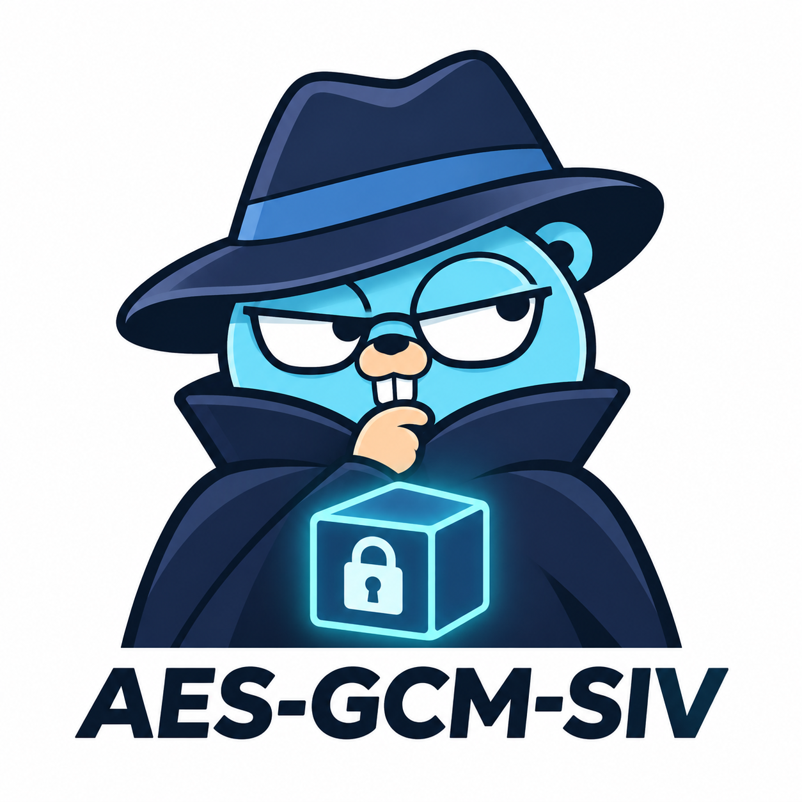

# aes-gcm-siv

Pure Go implementation of **AES-GCM-SIV** (RFC 8452), the nonce
misuse-resistant authenticated encryption algorithm, ported from
[AWS-LC](https://github.com/aws/aws-lc)'s C implementation
(`crypto/cipher_extra/e_aesgcmsiv.c`).

- **Pure Go, standard library only.** No cgo, no assembly, no third-party
  dependencies. AES uses `crypto/aes` (hardware accelerated where the
  platform supports it); POLYVAL is implemented natively.
- **Both key sizes.** 16-byte keys (AEAD_AES_128_GCM_SIV) and 32-byte keys
  (AEAD_AES_256_GCM_SIV) through one API.
- **Standard API.** Implements `cipher.AEAD`, so it drops into any code
  written against the Go cryptography interfaces.
- **Optimized for speed.** Adaptive POLYVAL (table-free dot products for
  short inputs, unrolled nibble tables for long inputs), minimal
  allocations, safe for concurrent use.

## Install

```sh
go get github.com/marcgauthier/aes-gcm-siv
```

Requires Go 1.21 or later.

## Usage

```go
package main

import (
	"crypto/rand"
	"fmt"
	"log"

	gcmsiv "github.com/marcgauthier/aes-gcm-siv"
)

func main() {
	key := make([]byte, gcmsiv.KeySize256) // or gcmsiv.KeySize128
	if _, err := rand.Read(key); err != nil {
		log.Fatal(err)
	}
	aead, err := gcmsiv.New(key)
	if err != nil {
		log.Fatal(err)
	}

	nonce := make([]byte, gcmsiv.NonceSize) // 12 bytes, must be unique per message
	if _, err := rand.Read(nonce); err != nil {
		log.Fatal(err)
	}

	ciphertext := aead.Seal(nil, nonce, []byte("hello"), []byte("ad"))
	plaintext, err := aead.Open(nil, nonce, ciphertext, []byte("ad"))
	if err != nil {
		log.Fatal(err)
	}
	fmt.Println(string(plaintext)) // hello
}
```

Notes:

- Nonces are 12 bytes; tags are 16 bytes (`Overhead()`).
- Unlike AES-GCM, repeating a nonce does not catastrophically destroy
  confidentiality, but nonces must still be unique whenever possible.
- `Open` returns an error (and no plaintext) when authentication fails.
  Oversized inputs are rejected per RFC 8452 Section 6
  (plaintext ≤ 2^36 bytes, additional data < 2^61 bytes).

## Correctness

Validated against:

- All 179 AES-GCM-SIV test vectors shipped with AWS-LC (RFC 8452
  Appendix C, the Section 8 worked example, reference-code random vectors,
  and the Appendix C.3 counter-wrapping tests), each checked for Seal,
  Open, and tag forgery rejection.
- All 155 Wycheproof `aes_gcm_siv` cases, including the constructed
  counter-overflow vectors.
- RFC 8452 intermediate values: the C.3 record keys and POLYVAL result,
  and the Appendix A field-doubling examples (per verified erratum 5854).
- An independent POLYVAL reimplementation through the GHASH relation of
  RFC 8452 Appendix A (mirroring AWS-LC's `polyval.c` approach),
  cross-checked on randomized inputs.
- Round-trip sweeps over message/ad lengths and both key sizes, tamper
  tests over every byte, and in-place (`dst` aliasing) operation.

Both internal POLYVAL implementations (direct and table-driven) run the
full suite.

## Performance

Seal/Open throughput in MB/s (higher is better) and latency in
microseconds, best of repeated runs on an Intel i5-6500 (Go 1.27,
linux/amd64). Small-message latency is dominated by the per-message
record-key schedule, which every `crypto/aes`-based implementation pays.

| size | Seal MB/s | Seal µs | Open MB/s | Open µs | allocs/op |
| --- | --- | --- | --- | --- | --- |
| 16 B | 18.5 | 0.87 | 13.0 | 1.23 | 3 |
| 64 B | 58.5 | 1.09 | 45.1 | 1.42 | 3 |
| 4 KB | 306 | 13.4 | 266 | 15.4 | 3 |
| 16 KB | 328 | 50.0 | 279 | 58.7 | 3 |
| 64 KB | 347 | 189 | 265 | 247 | 3 |
| 1 MB | 297 | 3527 | 279 | 3754 | 3 |

Design notes:

- The per-message AES-GCM-SIV key schedule (`aes.NewCipher` on the
  derived record key) is inherent to the construction and dominates
  small-message latency in every implementation built on `crypto/aes`.
- POLYVAL adapts to input length: short inputs use table-free
  Karatsuba dot products (BoringSSL `gcm_nohw` technique, no setup cost);
  long inputs amortize unrolled nibble multiplication tables that stay
  resident in L1 cache.
- 3 allocations per Seal/Open (output, record-key schedule, one scratch
  pad); the POLYVAL path itself allocates nothing.

## Comparison with other Go packages

Seal throughput in MB/s (higher is better), best of repeated runs on
the same machine. Open tracks Seal closely for every implementation.

| size | ours | ericlagergren | tink | cryptonite | fernandezvara |
| --- | --- | --- | --- | --- | --- |
| 16 B | 18.5 | 29.9 | 8.4 | 6.2 | 1.4 |
| 64 B | 58.5 | 101 | 30.5 | 28.7 | 2.4 |
| 512 B | 181 | 332 | 97.3 | 53.5 | 3.0 |
| 4 KB | 306 | 468 | 126 | 59.2 | 2.7 |
| 16 KB | 328 | 513 | 127 | 56.9 | 3.0 |
| 64 KB | 347 | 486 | 135 | 56.8 | 2.9 |
| allocs/op (16 B / 64 KB) | 3 / 3 | 1 / 1 | 11 / 11 | 11 / 11 | 12 / 12 |

Method: each package encrypts/decrypts the same plaintexts on this machine
(Intel i5-6500, Go 1.27, linux/amd64); best of repeated runs. All
implementations were first checked against RFC 8452 test vectors
(`ericlagergren`, `fernandezvara`, `cryptonite` reproduce the RFC tags
exactly; Tink round-trips). Tink uses random nonces per encryption
(`crypto/rand` cost included) and prepends no prefix (NoPrefix template).

Notes:

- `ericlagergren/siv` uses PCLMUL assembly for POLYVAL, which pure Go
  cannot match per byte; it is the fastest of the five.
- `fernandezvara/aesgcmsiv` is the only other stdlib-only
  implementation; this package is faster by roughly one to two orders of
  magnitude depending on size.

## Layout

- `gcmsiv.go` — `cipher.AEAD` implementation: key derivation (RFC 8452
  Section 4), tag computation, counter-mode encryption.
- `polyval.go` — POLYVAL (RFC 8452 Section 3): field arithmetic, direct
  dot products, nibble multiplication tables.
- `gcmsiv_test.go` — tests and Seal/Open benchmarks.
- `polyval_bench_test.go` — internal POLYVAL tuning benchmarks.
- `testdata/` — vector files verbatim from AWS-LC / Wycheproof.

## License

Apache License 2.0 — see [LICENSE](LICENSE). This package is based on
the AES-GCM-SIV C implementation in AWS-LC; see
[THIRD-PARTY-LICENSE.md](THIRD-PARTY-LICENSE.md) for the original
sources and their licenses.

## Porting notes

Behavior follows AWS-LC's portable (`e_aesgcmsiv.c`, non-asm) code path:
KDF counter layout (`LE32(i) || nonce`, 8 bytes kept per block), POLYVAL
over AD then plaintext then the bit-length block, nonce xor with top-bit
clear, tag encryption, and little-endian wrapping 32-bit counter mode
starting from the tag with the top bit set.
